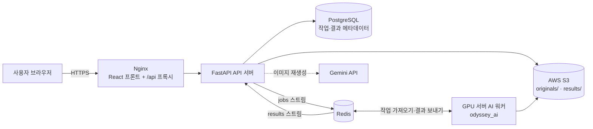

# Odyssey 백엔드

**게시 전에 사진과 글 속 개인정보를 찾아 주고, 사용자가 고른 방식으로 가려 주는 서비스**의 API 서버·웹 프론트·인프라입니다.

SNS에 올린 사진 한 장에서 간판, 번호판, 교복, 창밖 풍경 같은 단서만으로 사는 곳이나 다니는 학교가 드러날 수 있습니다. Odyssey는 업로드한 게시물(사진 최대 4장 + 글)을 AI로 분석해 위험한 단서를 위험도와 함께 보여 주고, 사용자가 가림·블러·모자이크·재생성 중에서 고르면 처리한 뒤 다시 검사해서 결과를 돌려줍니다.

AI 분석은 [odyssey_ai](https://github.com/odyssey-hackerton/odyssey_ai) 레포의 GPU 워커가 하고, 이 레포는 그 앞단(업로드, 작업 관리, 화면, 저장소)을 맡습니다.

## 주요 기능

- **게시물 단위 분석**: 사진 0~4장과 글을 한 번에 올리면 사진마다 작업을 만들어 묶어서 관리
- **실시간 진행 표시**: 탐지 → 분석 → 변환 → 재검증 상태를 SSE로 전달
- **보호 편집 화면**: 단서별로 처리 방법을 고르고 영역을 조절 (가림, 블러, 모자이크, 부분 가림, 삭제, 이미지 재생성)
- **위험도 정책 검사**: 위험도가 높은 단서를 약하게 처리하려 하면 거절하고 이유를 보여 줌
- **원본 즉시 삭제**: 탐지가 끝나면 서버의 원본을 지우고, 결과 사진은 메타데이터(EXIF 등)를 지운 채 다시 인코딩
- **공유**: 완성한 사진과 글을 Web Share로 X 등에 바로 공유

## 아키텍처



| 구성 요소 | 역할 |
| --- | --- |
| FastAPI (`app/`) | 업로드 검증, 작업 등록, 진행 상태 SSE, 결과·리포트 제공, 정책 검사 |
| React (`frontend/`) | 6단계 보호 편집 화면 (Vite) |
| Nginx (`nginx/`) | 프론트 서빙, `/api` 리버스 프록시, HTTPS |
| PostgreSQL | 작업·게시물·결과 메타데이터 (Alembic 마이그레이션) |
| Redis | 작업 큐 `jobs`, 결과 큐 `results`, 진행 상태 `job:{id}` |
| AWS S3 | 원본 사진(`originals/`, 1일 뒤 자동 만료)과 결과 사진(`results/`) |
| Mock 워커 (`mock_worker/`) | AI 워커 없이 전체 흐름을 시연·개발하기 위한 가짜 워커 |
| LiteLLM (`litellm/`) | LLM/VLM 프록시·폴백, 키별 사용량 관리 (선택) |

### 처리 흐름

1. 프론트가 `POST /api/posts`로 사진과 글을 올림 → API가 검증 후 S3에 원본을 저장하고 Redis `jobs`에 작업 등록
2. AI 워커가 ① 탐지 → ② 위험 분석을 하고 `AWAITING_USER` 상태로 결과를 보냄 (원본은 이때 삭제)
3. 사용자가 편집 화면에서 처리 방법을 고르면 `POST /api/posts/{id}/transform`으로 선택과 원본을 다시 보냄 (원본 해시가 처음과 같아야 함)
4. 워커가 ③ 변환 → ④ 재검증 후 결과 사진을 S3 `results/`에 올리고 `results` 큐로 알림
5. API가 결과를 DB에 반영하고, 프론트는 `/result`·`/report`로 처리된 사진과 남은 단서를 받음

API와 워커는 큐 메시지로만 통신합니다. 메시지 형식은 [`app/schemas/contract.py`](app/schemas/contract.py)에 있습니다.

## 빠른 시작

### 백엔드

필요: Python 3.12, [uv](https://docs.astral.sh/uv/)

```bash
git clone https://github.com/odyssey-hackerton/odyssey_backend.git
cd odyssey_backend
./scripts/setup-git-hooks.sh   # 커밋 규칙 훅 (기여할 때)
uv sync
uv run ruff check . && uv run pytest
```

### 프론트

필요: Node.js 20 이상

```bash
cd frontend
npm install
npm run dev                                     # 로컬 백엔드(localhost:8000) 사용
VITE_API_TARGET=https://10.1.1.27 npm run dev   # 서버 API 사용 (VPN 필요)
```

http://localhost:5173 에서 확인합니다. 백엔드 없이 화면만 보려면 홈에서 **예시로 먼저 둘러보기**를 누르세요. 자세한 화면 흐름은 [frontend/README.md](frontend/README.md)에 있습니다.

### 전체 구성 (Docker Compose)

```bash
cp .env.example .env          # 값 채우기 (아래 표)
docker compose --env-file .env up -d
uv run python scripts/smoke_test.py http://localhost   # 업로드 → 진행 → 결과 확인
```

`.env`의 `COMPOSE_PROFILES=mock`이면 Mock 워커가 함께 떠서 AI 워커 없이 전체 흐름을 볼 수 있습니다. 실제 워커를 붙일 때는 이 줄을 지웁니다.

서버 배포, HTTPS 인증서, S3·IAM 설정, LiteLLM 설정은 [docs/operations.md](docs/operations.md)를 보세요.

## 환경 변수

`.env.example`을 복사해서 채웁니다. `.env`는 커밋하지 않습니다.

| 변수 | 설명 | 기본값 |
| --- | --- | --- |
| `DOCKERHUB_USER`, `IMAGE_TAG` | 배포 이미지 위치 | `latest` |
| `APP_ENV`, `LOG_LEVEL` | 실행 환경, 로그 수준 | `production`, `INFO` |
| `HTTP_PORT` | Nginx 포트 | `80` |
| `COMPOSE_PROFILES` | `mock`이면 Mock 워커 실행 | `mock` |
| `POSTGRES_USER`, `POSTGRES_PASSWORD`, `POSTGRES_DB` | PostgreSQL 계정 (비밀번호는 영문·숫자만) | `odyssey` |
| `REDIS_PASSWORD`, `REDIS_BIND` | Redis 비밀번호, GPU 워커가 접속할 사설 IP | `127.0.0.1` |
| `S3_BUCKET`, `S3_REGION` | 이미지 버킷 | `odyssey-hackarton-images`, `ap-northeast-2` |
| `AWS_ACCESS_KEY_ID`, `AWS_SECRET_ACCESS_KEY` | API 서버용 IAM 키 | - |
| `PRESIGN_EXPIRES_SECONDS` | 결과 presigned URL 유효 시간(초) | `300` |
| `MOCK_STEP_SECONDS`, `MOCK_FAIL_RATE` | Mock 워커 단계 간격, 실패 비율 | `1`, `0` |
| `GEMINI_API_KEY`, `GEMINI_IMAGE_MODEL` | 이미지 재생성용. 비우면 재생성 기능이 꺼짐 | - |

컨테이너 밖에서 직접 실행할 때는 `DATABASE_URL`, `REDIS_URL`도 지정합니다 (기본값은 `localhost`).

## API 요약

전체 요청·응답 형식은 서버의 Swagger 문서(`/docs`)에 있습니다.

**게시물 API** (웹 화면이 사용)

| 메서드 | 경로 | 설명 |
| --- | --- | --- |
| `POST` | `/api/posts` | 사진 0~4장(`files`) + 글(`text`) 업로드. `202` + `post_id` |
| `GET` | `/api/posts/{id}` | 게시물 전체 상태와 항목별 상태 |
| `GET` | `/api/posts/{id}/events` | SSE: `progress`, `awaiting_user`, `done` |
| `GET` | `/api/posts/{id}/report` | 항목별 단서(`findings`)와 위험도 |
| `POST` | `/api/posts/{id}/transform` | 사용자 선택(`choices`) + 원본 사진으로 변환 시작 |
| `GET` | `/api/posts/{id}/result` | 처리된 글과 항목별 결과 사진 주소 |

**작업 API** (사진 1장 단위)

| 메서드 | 경로 | 설명 |
| --- | --- | --- |
| `POST` | `/api/jobs` | 사진(`file`, jpg·png·webp, 10MB 이하) 또는 글(`text`, 5,000자 이하) 또는 둘 다 |
| `GET` | `/api/jobs/{id}` | 상태: `QUEUED` `DETECTING` `ANALYZING` `AWAITING_USER` `TRANSFORMING` `VERIFYING` `DONE` `FAILED` |
| `GET` | `/api/jobs/{id}/events` | SSE 진행 이벤트 |
| `GET` | `/api/jobs/{id}/report` | 위험도 전후, 탐지 항목, 반복 횟수 |
| `POST` | `/api/jobs/{id}/transform` | 사용자 선택으로 변환 시작 |
| `GET` | `/api/jobs/{id}/result` | 결과 (presigned URL / 가린 글) |
| `GET` | `/api/jobs/{id}/image` | 결과 사진을 서버를 거쳐 내려줌 (공유·다운로드용) |

**기타**

| 메서드 | 경로 | 설명 |
| --- | --- | --- |
| `GET` / `POST` | `/api/images/regenerate` | Gemini로 선택 영역 배경 재생성 (GET은 사용 가능 여부만) |
| `GET` | `/api/health` | DB·Redis 확인. `?deep=true`면 S3까지 |

## 폴더 구조

```
app/
  api/          라우터 (posts, jobs, regeneration, health)
  core/         설정(.env), 로깅
  db/           SQLAlchemy 모델, 세션
  queue/        Redis 작업 등록, 결과 소비, 진행 상태
  schemas/      API 응답, 워커 메시지 계약(contract.py)
  services/     업로드 검증, 정책 검사, 이미지 재생성
  storage/      S3 클라이언트
frontend/       React(Vite) 보호 편집 화면
migrations/     Alembic (API 컨테이너 시작 시 자동 적용)
mock_worker/    개발용 가짜 AI 워커
nginx/          Nginx 설정, odyssey-web 이미지 Dockerfile
litellm/        LiteLLM 프록시 설정
scripts/        이미지 빌드·푸시, 스모크 테스트, git 훅 설치
tests/          pytest
docs/           운영 상세, 화면·API 계획
```

## 기술 스택

FastAPI · SQLAlchemy(async) · Alembic · PostgreSQL · Redis Streams · AWS S3 · React + Vite + TypeScript · Nginx · Docker Compose · Gemini API

## 협업

브랜치·커밋·PR 규칙은 [CONTRIBUTING.md](CONTRIBUTING.md)에 있습니다. 요약하면 `dev`에서 `<type>/<이슈번호>-<설명>` 브랜치를 따고, 커밋은 `<type>(<scope>): 메시지` 형식, PR은 `dev`로 올려 승인 1개 + convention-check 통과 후 머지합니다.

## 팀

해커톤 팀 Odyssey
